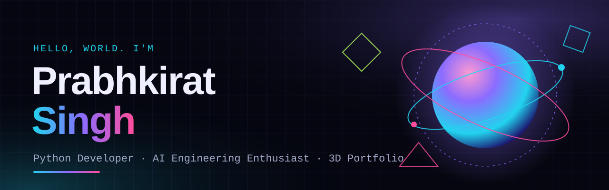

<div align="center">



<br>

# ✦ 3D Developer Portfolio

**An immersive, WebGL-powered portfolio — with a particle-built AI twin you can poke, explode and chat with.**

<br>


</div>

---

## ✨ Highlights

| | |
|---|---|
| 🌌 **Living 3D backdrop** | A custom GLSL shader orb with simplex-noise displacement, orbiting rings, a 2,600-particle star field and floating shards — all driven by mouse and scroll. |
| 🧬 **AI Twin** | A portrait cut out from a single photo and rebuilt as ~40,000 colour-sampled particles. Move the mouse to repel them, click for a shockwave, or hit **Explode**. |
| 🎛️ **Four visual modes** | Real · Hologram · Neon · Matrix — switched live in the vertex shader. |
| 💬 **Chat with the twin** | A scripted (no cloud AI) assistant that answers questions about projects, stack, education and contact — and makes the avatar "talk". |
| 🎬 **Scroll choreography** | The orb glides between anchors and re-colours itself for every section; velocity makes it wobble. |
| 🖱️ **Micro-interactions** | Custom cursor, magnetic buttons, 3D tilt cards with glare, count-up stats, a draggable 3D skill sphere and a timeline that fills as you scroll. |
| 🎟️ **Sticker Wall** | A laptop lid covered in 16 draggable, throwable, tap-to-spin stickers with holographic foil shine — including die-cut stickers of me (downloadable as PNG or a WhatsApp-ready 512×512 `.webp`). |
| ⌨️ **Command palette** | Press <kbd>Ctrl</kbd>+<kbd>K</kbd> (or `/`) to jump to any section, switch twin modes, explode the avatar, download the résumé and more. |
| 🎉 **Party mode** | Hidden Konami code (↑ ↑ ↓ ↓ ← → ← → B A) — confetti cannons, emoji rain, a hue-cycling universe. |
| 🐙 **Live GitHub feed** | Real repos pulled from the public GitHub API at runtime (hidden automatically if offline or rate-limited). |
| 🔊 **Sound FX** | Optional WebAudio-synth blips and booms — off by default. |
| 📱 **Responsive & accessible** | Mobile layout, `prefers-reduced-motion` support and graceful fallback if WebGL is unavailable. |

## 🧭 Sections

1. **Home** — shader orb, typed role rotator, call-to-action
2. **About** — summary, holographic 3D ID card, stats
3. **AI Twin** — particle avatar + chat
4. **Projects** — SmartCrowd, Hostel Complaint Management System, Data & AI projects, live GitHub feed
5. **Skills** — interactive 3D tag-cloud sphere + grouped toolkit
6. **Sticker Wall** — draggable stickers on a laptop lid
7. **Journey** — education, training and certifications timeline
8. **Contact** — email, LinkedIn, GitHub, phone and résumé download

## 🛠️ Tech stack

- **Three.js (r128)** for the scene, custom `ShaderMaterial`s and particle systems
- **Vanilla JavaScript**, **CSS3** and semantic **HTML5** — no framework, no build step
- **Google Fonts** — Syne, Space Grotesk, JetBrains Mono
- **Python + OpenCV (GrabCut)** was used once, offline, to cut the portrait out of the original photo

## 🚀 Run locally

No install needed — it's a static site.

```bash
# clone
git clone https://github.com/Prabkiratt/my-portfolio.git
cd my-portfolio

# serve (any static server works)
python -m http.server 5173
```

Then open <http://localhost:5173>. Opening `index.html` directly also works in most browsers.

> An internet connection is required for the Three.js CDN and Google Fonts.

## 📁 Project structure

```text
my-portfolio/
├── index.html                    # markup for every section
├── style.css                     # design tokens, layout, animations
├── main.js                       # Three.js scene, scroll logic, AI twin, chat
├── extras.js                     # stickers, command palette, party mode, sound, GitHub feed
├── assets/
│   ├── avatar-data.js            # embedded portrait used to build the particles
│   ├── avatar_cutout.png         # background-removed portrait
│   ├── avatar_head.png           # head & shoulders crop for the ID card
│   ├── stickers/                 # die-cut sticker PNGs + WhatsApp .webp
│   └── banner.svg                # README banner
└── Prabhkirat_Singh_Resume.pdf   # downloadable résumé
```

## ☁️ Deploy

The site is plain static files, so any static host works:

- **Vercel / Netlify** — import the repo, framework preset *Other*, root `./`, no build command.
- **GitHub Pages** — *Settings → Pages → Deploy from branch → `main` / root*.

## 🎨 Customising

- **Content** — edit the text in `index.html` (and the answers in the `KB` array at the bottom of `main.js` for the chat).
- **Colours** — change the CSS variables at the top of `style.css` and the per-section `palettes` in `main.js`.
- **Your own avatar** — replace `assets/avatar_cutout.png`, then regenerate `assets/avatar-data.js` (a ~180 px-wide base64 data URI of the cutout).

## 👤 About me

**Prabhkirat Singh** — BCA student at PCTE Group of Institutes, Ludhiana, eager to contribute to software applications and Agentic AI integrations as a Python Developer or IT Intern.

[](https://www.linkedin.com/in/prabhkirat-singh-6aa70823b/)
[](https://github.com/Prabkiratt)
[](mailto:prabhkirat1006@gmail.com)

<div align="center">

<sub>Built with Three.js, a lot of shaders and an unreasonable number of particles ✦</sub>

</div>
